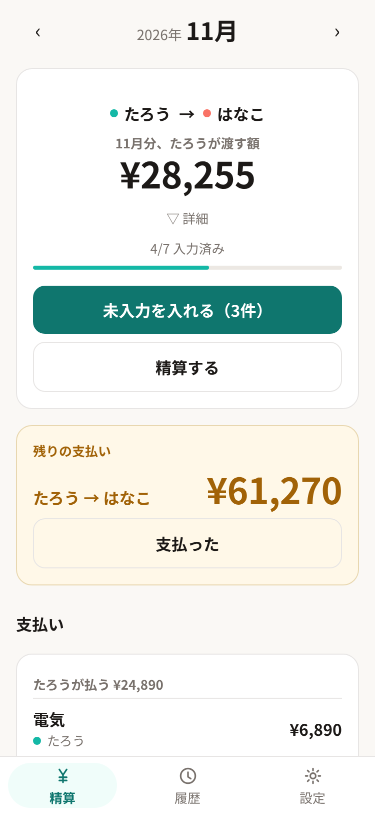
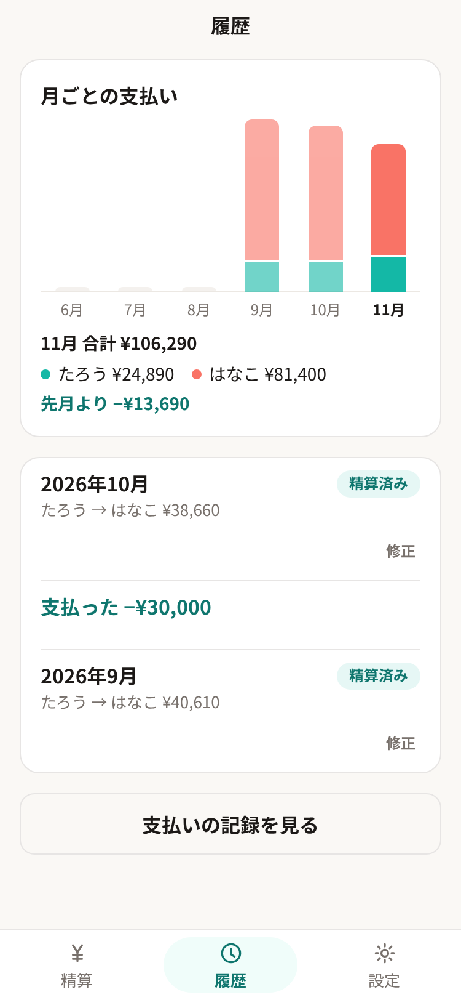
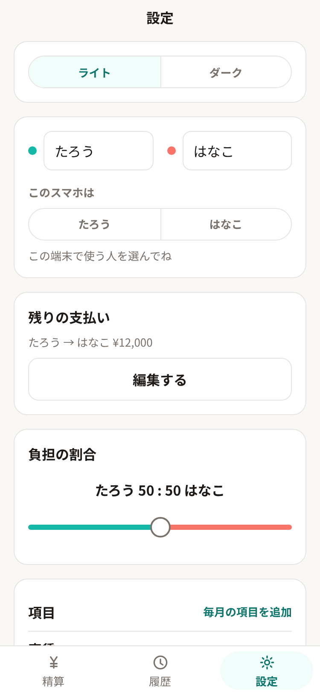
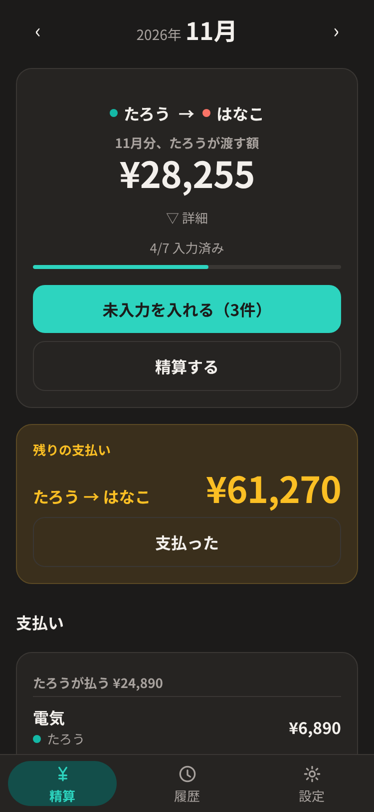
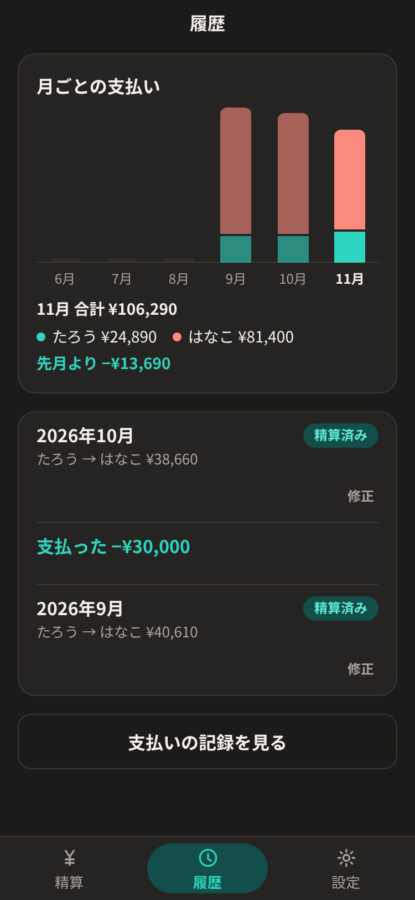
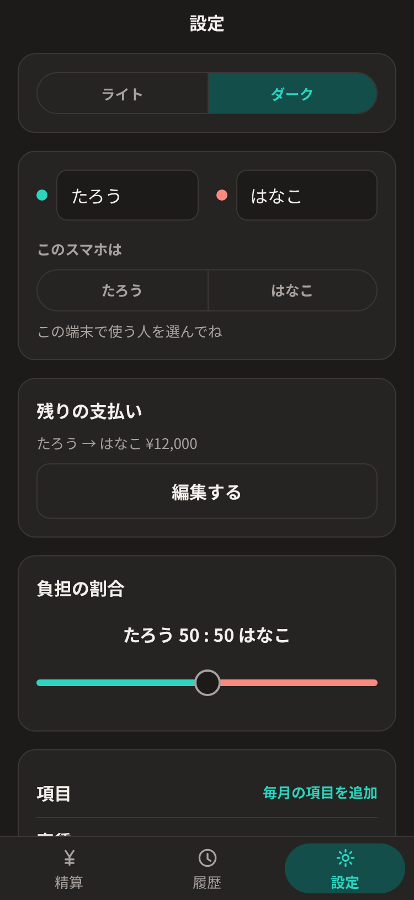
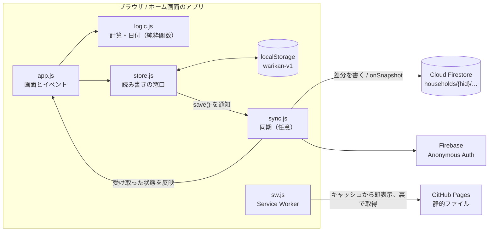

# わりかん

> **English summary** — *Warikan* is a small offline-first PWA that a real couple uses every month to record shared bills (rent, utilities, groceries) and work out who owes whom at the end of the month. It is plain HTML/CSS/vanilla JS with no build step, hosted on GitHub Pages. Data lives in `localStorage`; an optional two-device sync uses Firebase Anonymous Auth + Firestore, protected by security rules that only let someone with a one-time invite token join a household of at most two members. Tested with Node unit tests, Firestore rules tests on the emulator, and Puppeteer end-to-end tests.

<table>
  <tr>
    <td align="center"></td>
    <td align="center"></td>
    <td align="center"></td>
  </tr>
  <tr>
    <td align="center"></td>
    <td align="center"></td>
    <td align="center"></td>
  </tr>
  <tr>
    <td align="center">精算</td><td align="center">履歴</td><td align="center">設定</td>
  </tr>
</table>

<sub>画面は 375px 幅。名前（たろう／はなこ）と金額はすべて例です。</sub>

**公開先:** https://yaching04.github.io/warikan/ （iPhone の Safari で開き、「ホーム画面に追加」するとアプリとして使えます）

## これは何か・なぜ作ったか

同棲しているふたりが、家賃や光熱費、買い物の支払いを記録して、月末に「どちらがいくら渡すか」をすぐ出すためのアプリです。

実際にふたりで毎月使いながら、使っていて出てきた要望（固定費の自動入力、精算の先送り、ふたりの端末での共有など）を少しずつ足してきました。利用者はいまのところこのふたりだけです。

## できること

- **毎月の項目**: 家賃などの固定費は金額入り、電気などの変動費は「未入力」の行として、月が変わると自動で並ぶ
- **精算カード**: 精算額を大きく出し、「詳細」で途中の式（それぞれが払った分と負担分）も見られる。入力の進捗バーつき
- **負担の割合**: 50:50 以外（例: 55:45）にも変えられる。端数で合計がずれない（[計算のしかた](#計算のしかた)）
- **精算して次の月へ**: 確定した月はその時点の割合と結果を保存し、あとから設定を変えても数字が変わらない。履歴の「修正」で確定を外せる
- **残りの支払い**: 精算額をすぐ渡せないときは持ち越し、「支払った」で少しずつ減らせる。記録は台帳で見られる
- **その月だけの支払い**: 精算ページの「項目を追加」はその月だけ。毎月の項目は設定から追加
- **履歴とグラフ**: 直近6か月の支払いを人ごとの積み上げ棒グラフで表示
- **ふたりで使う（任意）**: 招待リンクで、もう1台の端末と同じデータを使える。共有中は「自分」視点の表示（「〇〇に払う」など）になる
- **バックアップ**: JSON ファイルに保存・戻す。精算のたびに保存を促す
- **ライト／ダーク**、キーボード操作、スクリーンリーダー向けの aria 属性、動きを減らす設定への対応

## 技術スタック

| 分類 | 使っているもの |
|---|---|
| フロントエンド | HTML / CSS / JavaScript（ES2020 程度、フレームワークなし、ビルドなし） |
| オフライン | Service Worker（キャッシュ優先＋裏で更新）、Web App Manifest |
| 保存 | `localStorage`（端末内が正） |
| 同期（任意） | Firebase Anonymous Auth、Cloud Firestore（`asia-northeast1`）。SDK は共有を使うときだけ CDN から動的 import |
| ホスティング | GitHub Pages |
| テスト | Node.js（`assert`）、`@firebase/rules-unit-testing` + Firestore エミュレータ、Puppeteer（`puppeteer-core` + Chrome） |

## アーキテクチャ



- **一方向の描画**: `state` を変える → `store.save()` → `render()` で今のタブを作り直す。ボタンは `data-act` 属性で区別し、`body` のクリックを `ACTIONS` 表から引く
- **logic.js は DOM に触らない**: 割り勘の計算、月の計算、金額入力の解釈はすべて純粋関数で、Node から直接テストできる
- **同期はモジュールごと差し替え可能**: `sync.js` は本番用の `FirebaseBackend` と、テスト用の `MemoryBackend` を同じインターフェースで持つ。ユニットテストと多くの E2E はメモリ版で動く

## 設計で決めたこと

**オフラインファースト。** 端末の `localStorage` を正とし、共有していなければ通信は一切しません（Firebase の SDK も読み込みません）。Service Worker はキャッシュから即表示し、裏で取得した新しい版があれば「新しい版があります・更新する」を出します。キャッシュ名は版ごとに変え（例: `warikan-v210`）、古いキャッシュは activate 時に消します。

**バックエンドを持たない。** 利用者がふたりで、やりたいことが「同じデータを2台で見る」だけなので、サーバーを書いて運用するより、Firestore のセキュリティルールでアクセスを絞る方が小さく安全に作れると判断しました。

**匿名認証＋招待トークン。** アカウント登録をさせたくなかったので、Firebase の匿名認証を使います。共有を始めた端末がランダムな世帯 ID（`hid`、128 bit）と招待トークン（128 bit）を作り、招待リンク `…/#join=<hid>.<token>` を相手に送ります。参加できるのは、トークンを知っていて、世帯がまだ1人のときだけです（[セキュリティルール](#セキュリティルール)）。

**同期の単位と衝突。** 支払い・項目・台帳・精算はそれぞれ1件ずつ Firestore のドキュメントにし、変わったものだけを書きます。各レコードは `id` と `updatedAt` を持ちます。支払いの編集は Firestore のトランザクションで「読んだときの `updatedAt` のままか」を確かめ、相手が先に直していたら、どちらを残すかを選ぶシートを出します。月の精算もトランザクションで、ふたりが同時に精算しても二重に確定しません。

**iOS の保存場所の分離への対応。** iPhone では、Safari、ホーム画面に追加したアプリ、LINE などのアプリ内ブラウザで、`localStorage` が別々です。そのため:
- 招待リンクには `?openExternalBrowser=1` を付け、LINE のアプリ内ブラウザでは参加せず「Safari で開いてから参加してね」と案内する
- ホーム画面のアプリでも参加できるよう、設定に「招待リンクで参加」（リンクを貼る欄）を置く
- iPhone の Safari で招待リンクを開いたときは、先にホーム画面に追加するよう案内する
- 「このスマホは」で、この端末がどちらの人かを選び直せる（表示だけの設定で、共有の状態は変えない）

**データの互換性。** 保存データ（`warikan-v1`）は読み込むたびに `normalize()` で形をそろえ、古い版のデータ（金額が文字列、項目 ID がない等）も読めるようにしています。人の ID は `yamada`（1人目）と `kanojo`（2人目）で固定です。初期の名前の名残ですが、保存データと Firestore の形に含まれるので変えていません。初めて使うときの表示名は「自分／相手」で、すでに名前を保存している人の画面は変わりません（画面の名前は設定で自由に変えられます）。

## セキュリティルール

Firebase の Web 設定（`apiKey` など）は、ブラウザから使う以上公開される前提の値です。守りは [`firestore.rules`](firestore.rules) で行います。

| 対象 | 読む | 書く |
|---|---|---|
| `households/{hid}` | メンバーだけ（一覧の取得は不可） | 作成: ログイン済みで、自分1人だけがメンバー、招待トークン16文字以上。更新: 下の「参加」だけ。削除: 不可 |
| `households/{hid}/invite/{token}` | パスのトークンとドキュメントのトークンが一致するときだけ | メンバーだけ |
| `payments` `items` `ledger` `settlements` `meta` | メンバーだけ | メンバーだけ |
| それ以外のパス | 不可 | 不可 |

「参加」の更新が通る条件（`isJoin()`）:
- 変えるのは `members` と `joinPresentedToken` だけ
- 示したトークンが世帯の `inviteToken` と一致し、`inviteToken` 自体は変えない
- 参加前のメンバーが2人未満で、ちょうど1人（自分）だけ増える。既存のメンバーは消せない
- すでにメンバーなら参加し直せない

ルールは `test/rules.test.js` でエミュレータに対して確かめています（3人目は参加できない、トークンを変えられない、削除できない、など）。

わかっている制限:
- メンバーどうしは、世帯の中のデータを自由に読み書きできます（フィールドの形までは検査していません）。ふたりで使う前提のためです
- 招待リンクを知っている人は、2人目がまだ参加していなければ参加できます。リンクは相手にだけ送る前提です
- 世帯ドキュメントは削除できないルールなので、「共有をやめる」はこの端末の接続を切るだけで、クラウドのデータとメンバーの登録は残ります

## デザイン

主な色（[`style.css`](style.css) の変数）と、WCAG のコントラスト比です。比は `node test/visual/contrast.js` で style.css から計算しています。

| 用途 | 文字 / 背景 | ライト | 比 | ダーク | 比 |
|---|---|---|---|---|---|
| 本文 | `--ink` / `--bg` | #1C1917 / #FAF8F5 | 16.50 | #F3F0EC / #1C1B1A | 15.14 |
| 本文（カード） | `--ink` / `--card` | #1C1917 / #FFF | 17.49 | #F3F0EC / #262422 | 13.61 |
| 補足の文字 | `--sub` / `--card` | #78716C / #FFF | 4.80 | #A8A29E / #262422 | 6.13 |
| 主ボタン | `--pri-ink` / `--pri` | #FFF / #0F766E | 5.47 | #1C1B1A / #2DD4BF | 9.24 |
| リンク・強調（ティール） | `--teal-ink` / `--card` | #0F766E / #FFF | 5.47 | #2DD4BF / #262422 | 8.31 |
| 残りの支払い（琥珀） | `--amb` / `--amb-bg` | #A16207 / #FFF8E8 | 4.65 | #FBBF24 / #3A2F1C | 7.85 |
| エラー | `--err` / `--card` | #DC2626 / #FFF | 4.83 | #F87171 / #262422 | 5.59 |
| 1人目の色（丸・棒） | `--c-y` / `--card` | #14B8A6 / #FFF | 2.49 | #2DD4BF / #262422 | 8.31 |
| 2人目の色（丸・棒） | `--c-k` / `--card` | #F97366 / #FFF | 2.74 | #FB8A7E / #262422 | 6.66 |
| 「このスマホは」の選択中（1人目） | `#FFF` / `--c-y` | #FFF / #14B8A6 | 2.49 | #FFF / #2DD4BF | 1.86 |
| 「このスマホは」の選択中（2人目） | `#FFF` / `--c-k` | #FFF / #F97366 | 2.74 | #FFF / #FB8A7E | 2.32 |

本文・補足・ボタン・強調・エラーの文字は、ライト・ダークとも 4.5:1 以上です。人の色（丸や棒グラフ）は文字ではなく飾りとして使っています。一方で、設定の「このスマホは」の選択中ボタン（白い文字を人の色で塗る）は 4.5:1 に届いていません。見た目を変えない方針の版のため、そのままにしています。

気をつけている点:
- **数字の幅をそろえる**: `body` に `font-variant-numeric: tabular-nums` を指定し、金額の桁が同じなら幅も同じになるようにしている
- **動きを減らす設定**: `prefers-reduced-motion: reduce` のときは、シートのスライド、月の横スライド、グラフの伸び、タブの印の移動などを止めるか、短いフェードに置き換える
- **シートの動き**: 下から出るシートは `cubic-bezier(.32,.72,0,1)` で 0.32 秒、閉じるときは見た目だけのコピーを下へ 0.24 秒で滑らせ、本物の dialog はすぐ閉じる

## 計算のしかた

ふたりが払った合計を設定した割合で分け、すでに払った分との差額を精算額にします。50:50 の例:

- はなこが払った ¥90,000 のうち、たろうの負担は ¥45,000
- たろうが払った ¥14,000 のうち、はなこの負担は ¥7,000
- 差し引き、たろう → はなこ ¥38,000

**端数**は、1人目の負担だけ切り捨て（`Math.floor`）、残りを2人目の負担にします。こうすると、画面の式の数字を足し引きした結果が必ず精算額と一致します。

例: ¥14,001 を 55:45 で分ける → 1人目 `Math.floor(14001 * 55 / 100)` = ¥7,700、2人目 14,001 − 7,700 = ¥6,301（合計 ¥14,001、ずれなし）

金額の入力は、全角数字・カンマ・空白・先頭の ¥／￥・末尾の「円」を受け付けます（「３０００」「¥4,000」「4000円」はどれも数値として保存）。小数やマイナスは「金額は0以上の整数で入れてね」と出します。

## テスト

| 種類 | コマンド | 内容 |
|---|---|---|
| lint | `npm run lint` | ESLint（`eslint.config.js`） |
| ユニット | `npm run test:unit` | `logic.test.js`（計算・日付・入力の解釈）、`store.test.js`（保存・正規化・バックアップ）、`sync.test.js`（メモリ版バックエンドで同期・参加・衝突） |
| ルール | `npm run test:rules` | Firestore エミュレータでセキュリティルールを確認（Java 21 が必要） |
| E2E | `npm run test:e2e` | Puppeteer で画面を操作。`test/e2e/` の機能別の spec（精算・台帳・履歴・設定・項目・共有） |
| E2E（同期） | `npm run test:e2e:emulator` | Auth / Firestore エミュレータを使う共有の spec（`// @emulator` の付いたもの） |

テストはいまのところローカルで実行しています（GitHub Actions の設定は準備中）。

E2E の実行には Chrome が必要です（既定は `/usr/bin/google-chrome`、`CHROME=...` で変更）。テストは時刻を 2026年11月15日 12:00 JST に固定して動きます。

見た目を変えていないことの確認には、`test/visual/capture.js` で主な画面（精算・履歴・設定・各シート、375px のライト／ダーク）を同じ例データで撮り、前後の画像をピクセル単位で比べています。

## ローカルで動かす

```sh
npm install        # テスト用の道具だけ（アプリ自体は依存なし）
npm start          # http://127.0.0.1:8766/ で配信
npm test           # lint + ユニットテスト
```

アプリはビルドなしの静的ファイルなので、`index.html` を置いたフォルダを任意の静的サーバーで配信すれば動きます。Service Worker は `localhost` / `127.0.0.1` / HTTPS でだけ登録されます。

共有（Firebase）を自分のプロジェクトで試す場合は、`sync.js` の `FIREBASE_CONFIG` を差し替え、Firebase コンソールで匿名認証を有効にし、`firestore.rules` を公開してください。

## ディレクトリ構成

```
.
├── index.html          画面の骨組み（テーマの先読みだけインラインで実行）
├── app.js              画面とイベント
├── logic.js            計算・日付・入力の解釈（純粋関数、Node でも動く）
├── store.js            localStorage の読み書き、正規化、バックアップ
├── sync.js             ふたりで使う同期（Firebase / メモリのバックエンド）
├── style.css           スタイル（ライト／ダークは CSS 変数で切り替え）
├── sw.js               Service Worker
├── manifest.json       PWA マニフェスト
├── icons/              アプリアイコン
├── firestore.rules     Firestore のセキュリティルール
├── firebase.json       エミュレータの設定
├── docs/screenshots/   README の画像
├── test/
│   ├── logic.test.js   ユニットテスト
│   ├── store.test.js
│   ├── sync.test.js
│   ├── rules.test.js   ルールのテスト（エミュレータ）
│   ├── serve.js        静的サーバー（npm start と E2E）
│   ├── e2e/            E2E（helpers.js と機能別の spec、run.js で一括実行）
│   └── visual/         見た目の確認用スクリーンショット、コントラストの計算
├── CHANGELOG.md
└── LICENSE
```

## 変更履歴

[CHANGELOG.md](CHANGELOG.md) を見てください。

## ライセンス

[MIT](LICENSE)
